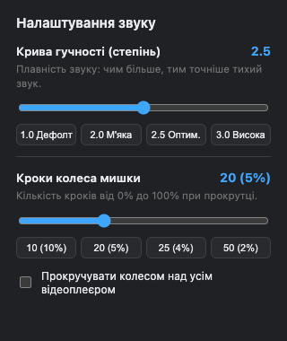

# YouTube Volume Fix

Browser extension (Manifest V3) that maps YouTube's linear volume slider to a perceptual power curve (exponent 2.5), enabling granular audio control at low volume levels.

  

## Features

- Dynamic volume scaling via HTMLMediaElement prototype hooking
- Options popup to adjust the exponent curve in real time (from 1.0 to 4.0)
- Customizable mouse wheel volume step size (default: 20 steps / 5% per scroll tick)
- Optional volume scrolling over the entire video player
- Zero external dependencies
- Isolated bridge communicating with the page's main execution context

## Options

- Volume curve exponent: Adjust how gently the audio ramps up at quiet volumes. Default is 2.5 (perceptually balanced). Presets: 1.0 (linear), 2.0 (soft), 2.5 (optimal), 3.0 (high precision).
- Mouse wheel steps: Choose between 5 and 50 iterations from 0% to 100% (default: 20 steps, which equals 5% volume change per notch).
- Scroll over entire video player: Toggle whether mouse wheel adjustment works anywhere over the player or only directly over the volume slider.

## Installation

### Option 1: Tampermonkey (Recommended for auto-updates across devices)

1. Install the [Tampermonkey](https://www.tampermonkey.net/) extension in your browser.
2. In Chrome, navigate to `chrome://extensions/` and enable "Developer mode" in the top right corner (required by Chromium Manifest V3 to execute userscripts).
3. Click this direct link: [Install yt-volume-fix.user.js](https://raw.githubusercontent.com/Magshproget/yt-volume-fix/main/yt-volume-fix.user.js).
4. Tampermonkey will detect the script and prompt you to click "Install".
5. Updates will be downloaded automatically from this GitHub repository.

### Option 2: Standalone Extension (Unpacked)

1. Clone or download this repository.
2. Open Chrome (or any Chromium browser: Brave, Edge, Arc) and navigate to `chrome://extensions/`.
3. Enable "Developer mode" in the top right corner.
4. Click "Load unpacked" and select the root directory of this repository.
